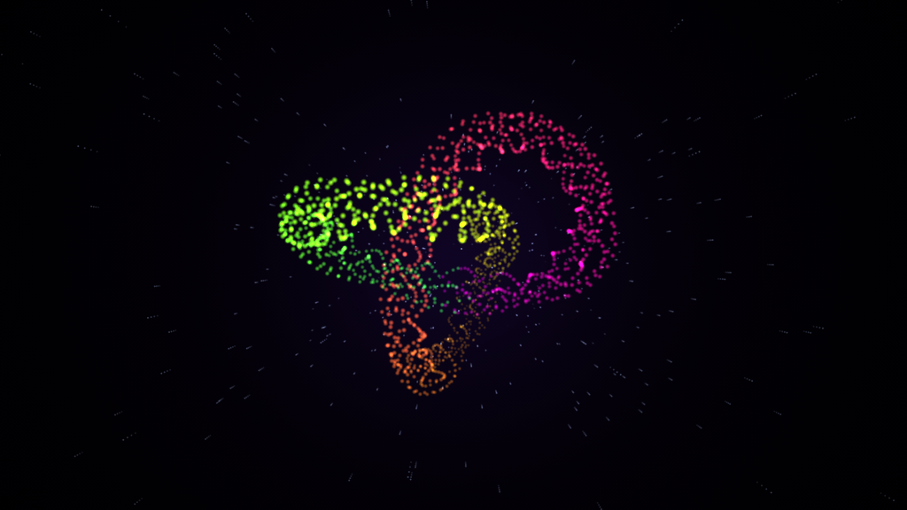
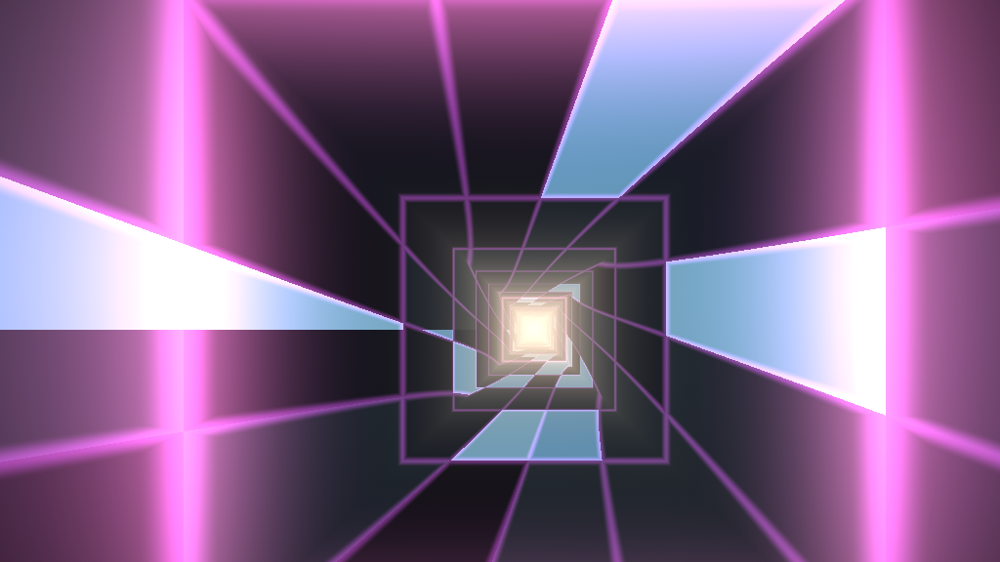
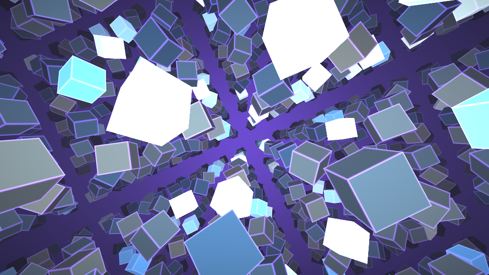
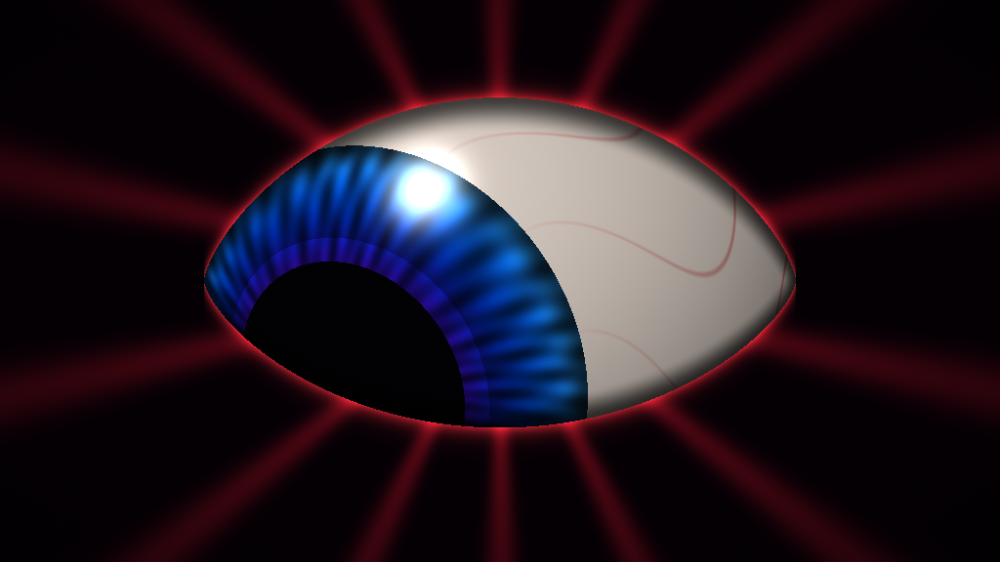

# WATCHER

A 60-second audiovisual demo written in plain C. **No files, no assets**: every
pixel and every sound is synthesized at runtime, and the whole thing compiles to
a tiny binary.

There are two versions:

| Version | Source | Output | Binary |
|---|---|---|---|
| **V1** | `demo.c` | Terminal, truecolor half-block "pixels" | `watcher` |
| **V2** | `demo_v2.c` | 1024×576 software-rendered X11 window | `watcher_v2` |

## Preview

Frames rendered from the V2 demo (timestamps in seconds):

| | |
|---|---|
|  |  |
| **0:13** – particle cloud morphing between shapes | **0:24** – synthwave horizon with grid and sun |
|  |  |
| **0:38** – flight through a neon tunnel | **0:48** – swarm of tumbling cubes |



**0:56** – the finale: an eye, followed by a fake segfault and a prompt that
answers `> yes.`

## How it works

- **Graphics** – everything is drawn by CPU code. V1 writes truecolor
  half-block characters to the terminal; V2 renders on all CPU cores at
  1024×576 and blits the frame to an X11 window (scaled to fit, letterboxed).
- **Audio** – a small real-time synthesizer streams PCM to PulseAudio, falling
  back to ALSA. Video time is locked to the audio clock, so picture and music
  stay in sync.
- **Zero link-time dependencies** – Xlib, PulseAudio and ALSA are loaded with
  `dlopen`, so the binaries link only against libc/libm and run without
  those libraries' development packages.
- **Size-optimized builds** – `-Os`, stripped, no unwind tables, and linker
  flags that shrink the ELF headers and pages (see `build.sh`).

## Scenes

| Time | Scene |
|---|---|
| 0:00 – 0:08 | Void, a pulsing dot |
| 0:08 – 0:18 | Particle cloud forming shapes |
| 0:18 – 0:30 | Synthwave horizon |
| 0:30 – 0:44 | Neon tunnel |
| 0:44 – 0:53 | Cubes, accelerating |
| 0:53 – 0:54 | The "crash" (the window vanishes, the shell prints `Segmentation fault (core dumped)`) |
| 0:54 – 0:59 | The eye |
| 0:59 – 1:00 | `> yes.` |

## Build

Requirements: `gcc` and libm. Linux only.

```sh
./build.sh
```

This produces `watcher` (V1) and `watcher_v2` (V2).

## Run

```sh
./watcher        # V1: run in a truecolor terminal
./watcher_v2     # V2: needs an X11 display; starts fullscreen
./watcher_v2 -w  # V2: windowed
```

V2 keys: `f` toggles fullscreen, `q` or `Esc` quits. Sound requires PulseAudio
or ALSA; without audio the demo still runs on a wall-clock timer.

## Repository layout

```
demo.c         V1 – terminal demo
demo_v2.c      V2 – X11 window demo
build.sh       builds both with size-optimizing flags
docs/images/   preview frames used in this README
```
